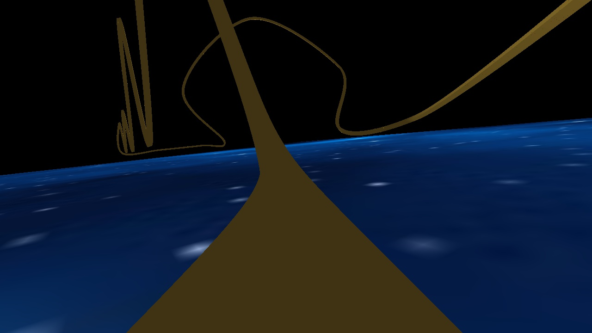
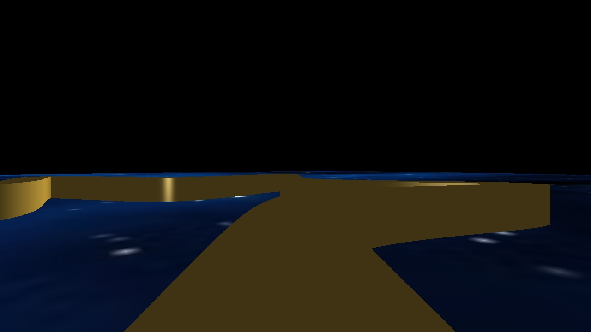
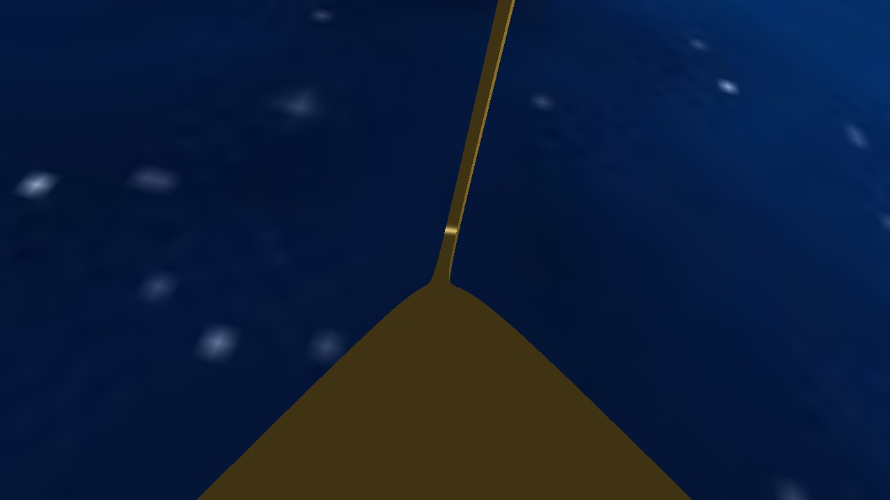

# OpenGL Roller Coaster Simulation


A 3D roller coaster simulation developed in C++ using OpenGL, featuring procedural track generation, Catmull-Rom spline interpolation, shader-based rendering, and an animated first-person camera.

## Demo Video

[▶ Watch the Roller Coaster Simulation on YouTube](https://youtu.be/J3221GacOmI)


## Overview


This project explores real-time computer graphics through the construction of a virtual roller coaster. Catmull-Rom splines define the track's trajectory, while OpenGL renders the scene using programmable shaders, texture mapping, and Phong shading.


An animated camera travels along the track, providing a first-person perspective of the ride.


## Features


- **Catmull-Rom Splines:** Smooth curve interpolation to define the roller coaster's path.

- **Procedural Track Generation:** Construction of 3D track geometry from spline data.

- **Camera Animation:** Continuous movement and orientation along the roller coaster path.

- **OpenGL Rendering:** Shader-based rendering with texture mapping and Phong shading.

- **Animation Capture:** Screenshot generation for recording the simulation.


## Technologies


- C++

- OpenGL

- GLSL

- Catmull-Rom spline interpolation


## Screenshots










## Building and Running


### Requirements


- Windows

- Visual Studio 2022 with the **Desktop development with C++** workload

- OpenGL-compatible graphics hardware and drivers

- Project dependencies included in the repository (see `external/`)


### Build Instructions


1\. Clone the repository:


&#x20;  ```bash

&#x20;  git clone https://github.com/dofranco/opengl-roller-coaster.git

&#x20;  ```


2\. Open `src/RollerCoaster.sln` in Visual Studio 2022.


3\. Select the **Debug** configuration and **Win32** platform.


4\. Build the solution using **Build → Build Solution** (`Ctrl + Shift + B`).


### Running the Simulation


The application requires a track definition file as a command-line argument.


1\. In Solution Explorer, right-click the **RollerCoaster** project and select **Properties**.


2\. Navigate to **Configuration Properties → Debugging**.


3\. Set the following properties:


&#x20;  - **Command Arguments:** `track.txt`

&#x20;  - **Working Directory:** `$(ProjectDir)`


4\. Click **Apply**, then **OK**.


5\. Press **F5** or select **Local Windows Debugger** to launch the simulation.


The program loads the specified track file and renders the roller coaster simulation.


### Custom Tracks


To load another track, replace `track.txt` in the command arguments with the path to another compatible track definition file.


For example:


```text

splines/custom-track.txt

```


Paths are resolved relative to the configured working directory.


### Controls


| Key | Action |

|---|---|

| `X` | Capture a screenshot of the current rendered frame |


### Screenshot Capture


Press **X** while the simulation is running to capture the current rendered frame. Screenshots are automatically saved to the `src/Screenshots/` directory.


## Project Background


Originally developed as part of the CSCI 420 Computer Graphics course at the University of Southern California.


The project uses course-provided starter code and supporting libraries. My work focused on implementing the roller coaster simulation, including spline-based track generation, rendering, and camera animation.


This repository presents a maintained portfolio version of the original project.


## Author


Daniel Franco


\[Portfolio](https://dannyfranco.net) | \[GitHub](https://github.com/dofranco)

